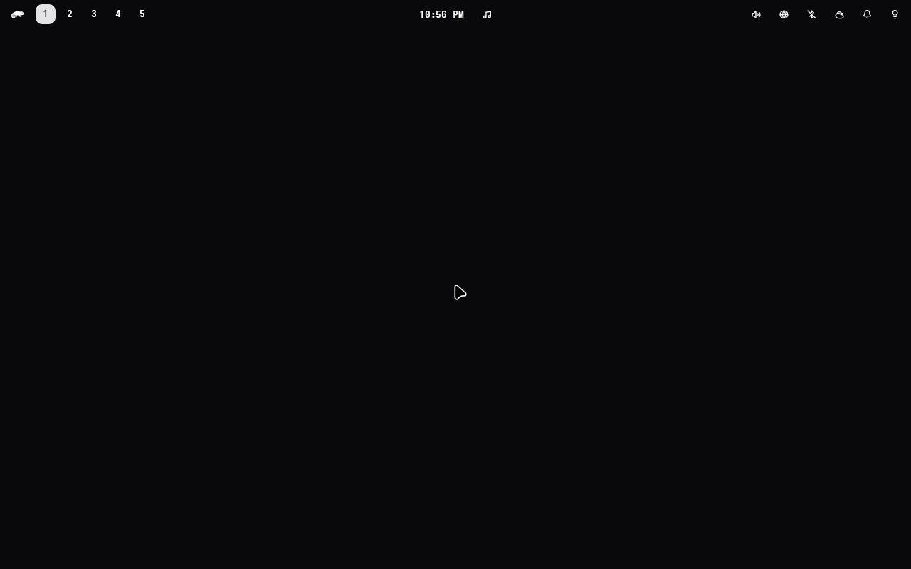

# The formalwm session

formalwm is FormalShell's window manager on ShojiWM (FormalStudio/FormalShell `wm/`, the
design in its `docs/superpowers/specs/2026-11-11-shoji.md`). It is a second session beside
Hyprland, and the default one per host is the `session` argument of `linux()` in
`hosts/<host>/host.star`: `hyprland-uwsm` or `formalwm-uwsm`. This file is the checklist for
switching a host: what `hyprland.lua` does besides managing windows, and where each of those
now lives.

## How the session starts

| Step | Hyprland | formalwm |
| --- | --- | --- |
| Greeter entry | `wayland-sessions/hyprland-uwsm.desktop` | `wayland-sessions/formalwm-uwsm.desktop` |
| What uwsm starts | `hyprland.desktop` (the distro's) | `/usr/local/share/wayland-sessions/formalwm.desktop`, which runs `/usr/local/libexec/formalwm-session`, which runs `formalwm --tty` |
| Boot, nothing picked | `formalshell-login.sh`: uwsm, Hyprland with `--locked-cmd` | `formalshell-login.sh` reads `/etc/formalshell-greeter/default-session`: uwsm, `formalwm.desktop --locked`, which sets `FORMALWM_START_LOCKED=1` |
| Environment | `~/.config/uwsm/env`, `env-hyprland` (g815: the NVIDIA card as `AQ_DRM_DEVICES`) | `~/.config/uwsm/env`, `env-shojiwm` (g815: sources `env-hyprland`, the card as `SHOJI_TTY_DRM_DEVICE`) |
| `XDG_CURRENT_DESKTOP` | `Hyprland` | `ShojiWM`, which the core sets whatever uwsm says |
| The shell | `formalshell.service` from `graphical-session.target`, or the locked login's `--locked-cmd` | `~/.config/formalwm/formalshell-start.sh`, which formalwm runs once its socket is up |
| Portals | `hyprland-portals.conf` | `shojiwm-portals.conf` |
| Logout | the shell exits Hyprland, uwsm stops the session | the shell's `session.exit`, formalwm quits, uwsm stops the session and unsets `SHOJIWM_SOCKET` (put on its list by `uwsm finalize` in the start script) |

`formalshell.service` and every `gui(..., formalshell = True)` unit run under either desktop
(`XDG_CURRENT_DESKTOP` Hyprland or ShojiWM) and never under Plasma or Gaming Mode. The greeter
offers the host's default first (`greeter.defaultSession` in its settings, from
`sessions.star`), unless the user picked another one last.

## hyprland.lua, top to bottom

Engine paths are in FormalStudio/FormalShell, `wm/`, at the rev `formalwm` is pinned to.
"Settings" is `~/.config/formalwm/settings.json` (shared) and `host.json` (per host, g815 only).

| Lines | What | Under formalwm |
| --- | --- | --- |
| 1-8 | The boot splash ends before the compositor opens the card | spec: `formalwm-session` starts `formalos-splash-quit.service` before `formalwm` |
| 10-32 | Window colours from `formalshell-colors.lua`, `hyprctl reload` | engine: the shell's `theme.set` on every connect and theme change (`formalwm/src/ipc.rs`); the fallback is `fs-wm-proto`'s `Theme::default()` |
| 34-73 | Rounding, blur, gaps, border, shadow, motion from `formalshell-chrome.lua` | engine: the same `theme.set` |
| 76-93 | Per-host `host.lua` | spec: `hosts/g815/home/.config/formalwm/host.json`, read by `core/src/settings.rs` over `settings.json`. e1504g has no `host.lua`, so it gets no `host.json`: the defaults (the laptop panel `eDP-1`, opacity 1) are what `hyprland.lua` gives it |
| 95-114 | The lid output dark while shut, flipped by the lid switch | engine: `lidOutput` (`core/src/settings.rs`, `formalwm/src/session.rs`), the core's lid switch. Proven headless only |
| 119 | Any other display at its highest refresh rate | settings: the catch-all `{ "mode": "highrr" }` |
| 122-135 | Nine named workspaces, the host's pins | settings, host.json |
| 138-151 | `XCURSOR_*`, `QS_ICON_THEME`, `QT_QPA_PLATFORMTHEME`, the host's GPU variables | engine: settings `env` and host.json `env` (`formalwm/src/session.rs`, `COMPOSITOR.env.apply`), which reach only what formalwm starts itself. Before formalwm starts: the cursor variables from `environment.d/10-session.conf` in the user manager, the rest from `uwsm/env` and g815's `env-shojiwm` |
| 155-183 | Keyboard, repeat, pointer and touchpad | settings `input`. Handed to the core's libinput; not proven on a real device |
| 184-308 | Gaps, border, tape, gestures, decoration, dim, opacity, blur | engine and settings. Group colours have no counterpart (no groups). Window opacity let less through than set in every engine build before `6f82047c`, the one pinned here (0.5 came out as 0.75, g815's 0.96 near opaque) |
| 279 | Black under everything | engine: `COMPOSITOR.output.set_clear_color` black (`formalwm/src/session.rs`), from the first frame |
| 284 | `focus_on_activate` | engine |
| 285 | `anr_missed_pings` | missing: the core has no dialog for a client that stopped answering. Proposal: drop, nothing depends on it |
| 288 | A restarted shell takes the lock back | core's session lock; lock and unlock proven, a restart while locked not yet |
| 294 | `direct_scanout = 0` on g815 (NVIDIA marks a fullscreen Vulkan swapchain out of date, black flashes in Sober) | missing: the core has no switch and the engine reads `directScanout` and ignores it. Proposal: a per-output scanout switch in the core, core agent. Watch Sober on g815 after the switch |
| 299 | `cm_auto_hdr = 1` | missing: the core has no automatic HDR. Proposal: core agent, after the switch |
| 306-308 | `xwayland.force_zero_scaling` | missing as a setting: X11 goes through the core's in-process xwayland-satellite, which scales on its own. Check an X11 app on g815's 1.25 panel after the switch |
| 318-322 | The DualSense touchpad: flat, 0.7 | settings `input.devices`. Not proven on the device |
| 329-346 | Animations on the shell's curves, no zoom on a new output | engine motion; nothing animates an output |
| 357-358 | Three-finger gestures | engine (`formalwm/src/gestures.rs`). Proven headless only |
| 360-415, 445-447 | The pointer hidden until the shell arrives, back after ten seconds without one | engine: `cursor_hidden` from the start, `wait_for_shell` (`formalwm/src/session.rs`), through the core's cursor override. No blank theme: the `formalos-blank` swap is Hyprland's alone |
| 417-434 | hypr-dynamic-cursors: lean and shake to find | missing: the core draws the cursor untransformed. Proposal: a cursor transform in the core, then the engine; core agent, after the switch. The `hypr-dynamic-cursors` package stays for Hyprland |
| 435-444 | XWayland's primary output, again on every new output | engine: `xwayland_primary` runs `xrandr` (`formalwm/src/session.rs`); `xrandr` is in `packages.star` |
| 452-593 | Every bind: the shell's IPC, volume, brightness, media, screenshots, the Copilot key (SUPER+SHIFT+F23), helium, lock and suspend, the MX Master's buttons | settings `binds`. SUPER+plus is bound twice in `hyprland.lua` (console and +10% width) and both are kept |
| 598-688 | Window rules: workspaces, floats, pins, Sober and Steam as games, Steam's idle pointer, picture in picture, Atoll's tag | settings `rules` |
| 643 | Minecraft confines the pointer | missing: no core hook for an X11 grab. Proposal: core agent, after the switch |
| 697-716 | Blur and alpha threshold per shell layer, no layer animation | settings `layers` (`formalwm/src/layers.rs`) |

## Outside hyprland.lua

| What | Where |
| --- | --- |
| `formalshell.service` gated on Hyprland | spec: either desktop |
| `gui(..., hyprland = True)` units (Discord, wl-clip-persist, panel-gamma, padbridge) | spec: `formalshell = True`, either desktop. panel-gamma needs wlr-gamma-control, which the core has (`gamma_control.rs`) |
| `gtk-session-css` before the session | spec: wanted by both sessions' pre targets |
| earlyoom's list of processes it spares | spec: `formalwm` added |
| Screencast and screenshot portals | spec: ShojiWM's portal for ScreenCast and Screenshot, gtk for the rest, gnome-keyring and trove as for Hyprland |
| The greeter's default | spec: `greeter.defaultSession` per host; needs the shell at or past FormalShell `b8e8eb0e` |
| Starting locked | engine: `FORMALWM_START_LOCKED=1` drives `ConfigBuilder::start_locked`: nothing but the lock surface is drawn, the start script still runs and starts the shell, which takes the lock on `$XDG_RUNTIME_DIR/formalshell/login-lock` as under Hyprland (`formalshell-login.sh` writes it for both). Until the shell locks the screen is black and takes no input; with no shell it stays so and binds do nothing |
| logind's `Desktop` at the boot login | `/etc/formalshell/login-env.conf` defaults `XDG_SESSION_DESKTOP` to Hyprland, so a formalwm boot login is recorded as Hyprland in `loginctl`. Cosmetic: uwsm and the core set the desktop the session uses |
| `~/.config/hypr/formalshell.lua` | the shell installer's Hyprland include, which `hyprland.lua` does not load. Nothing to move |

The shell matches on no desktop name: its OnlyShowIn and NotShowIn filter reads whatever
`XDG_CURRENT_DESKTOP` holds, so `ShojiWM` passes through. It uses no portal either
(screenshots through grim, recordings through wf-recorder, both wlr-screencopy, thumbnails
through the toplevel capture protocol), so the portals only matter to other apps.

## The Screenshot portal

ShojiWM's own portal answers Screenshot as well as ScreenCast from ShojiWM `85f78ef` on
(`4d0514924`), so `shojiwm-portals.conf` names `shojiwm` for both and no wlr portal is installed.

## Proven on the VM

fstestvm3 on g815, software rendering, with the spec of this branch: formalwm at FormalShell `6f82047c`,
ShojiWM at `85f78ef`, the shell at `ffb11cc3`.

| What | How |
| --- | --- |
| Boot into formalwm, locked | the boot's autologin with `FORMALWM_START_LOCKED=1`, recorded every 200 ms from power on: the boot splash, then black only, then the shell's boot lock (the splash's last picture dissolving into the backdrop, then the card). No frame shows the bar, a window or the wallpaper before it. The start script ran (it alone starts `formalshell.service`, which has no `WantedBy`), and the password opens the desktop |
| The greeter offers formalwm | preselected after a logout, beside Hyprland's entry |
| A greeter login reaches the bar over a window | foot from SUPER+Return, `graphical-session.target` and `formalshell.service` active with `XDG_CURRENT_DESKTOP=ShojiWM` and `SHOJIWM_SOCKET` |
| The Screenshot portal | answered by ShojiWM's own portal ("serving ScreenCast and Screenshot"), with no wlr portal installed; the picture shows the bar over foot |
| Lock and unlock | the shell's lock, unlocked by password |
| Logout | back to the greeter; no formalwm, Xwayland, shell, portal or client left, `SHOJIWM_SOCKET` gone from the user manager |
| Hyprland from the same greeter | logs in, the shell runs with `XDG_CURRENT_DESKTOP=Hyprland` |
| The pointer | Bibata-Modern-Classic, the arrow on the desktop and its text beam over foot |

With no theme found under `XCURSOR_PATH` (and openSUSE ships no `default` theme), the core draws its
own outline glyph (`fallback_cursor_image` in ShojiWM's `src/shojiwm_lib/src/cursor.rs`), as the VM
did before it had the `bibata` package and the cursor variables
([shoji-session/fallback-cursor.png](shoji-session/fallback-cursor.png), at the centre). Hyprland
falls back to its own logo there. The real hosts carry both, so the owner's first login gets
Bibata; after the switch, check the pointer once on each host. A fallback to an installed theme
such as Adwaita before the glyph is a candidate core patch.
